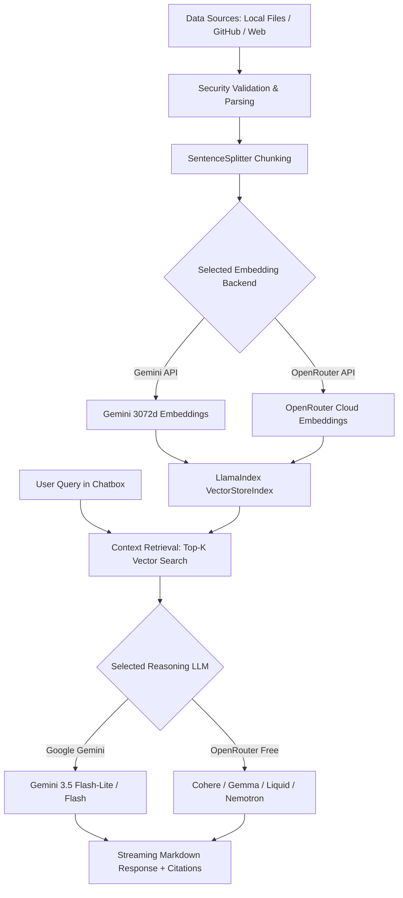

# NexusRAG ⚡

[](https://www.python.org/downloads/)
[](https://streamlit.io/)
[](https://www.llamaindex.ai/)
[](tests/)
[](SECURITY.md)
[](LICENSE)

**Autonomous Multi-Engine Retrieval-Augmented Generation (RAG) Platform**

NexusRAG is an enterprise-ready intelligent retrieval platform engineered to index, search, and converse with local files, full GitHub repositories, and live web intelligence. Designed for zero-friction operation on any computer, NexusRAG pairs high-performance **Google Gemini** reasoning and **OpenRouter Free Tier Models** with flexible cloud or local offline vector embeddings.

---

## 🌟 Why NexusRAG?

| Feature | Traditional Local RAG | NexusRAG v2.0 |
| :--- | :--- | :--- |
| **Infrastructure Overhead** | Heavy local daemons (Ollama, vLLM), 8GB+ GPU VRAM | **Zero daemon overhead**, runs on any standard laptop or VM |
| **Model Ecosystem** | Limited by local hardware capacity | **Dual Cloud AI**: Google Gemini + OpenRouter Free Tier |
| **Vector Embeddings** | Rigid, single-backend embeddings | **Dual Cloud**: Gemini 3072d Native, OpenRouter Cloud (BGE-Large, OpenAI) |
| **File Format Support** | Usually text and PDF only | **Universal**: Excel, Word, PowerPoint, PDF, CSV, Notebooks, Repos, Web |
| **Setup Complexity** | Complex terminal commands and CUDA drivers | **One-Click**: `setup.bat` automated Windows setup or clean pip |

---

## 🚀 Key Features

### 🧠 Dual-Engine Cloud AI Reasoning
- **Google Gemini**: Rapid, accurate synthesis powered by `gemini-3.5-flash-lite`, `gemini-3.5-flash`, and flagship models with automatic rate-limit backoff and jitter retry handling.
- **OpenRouter Free Tier**: Zero-cost community access to verified free models including:
  - `cohere/north-mini-code:free`
  - `liquid/lfm-2.5-2.6b:free`
  - `google/gemma-4-31b-it:free`
  - `nvidia/nemotron-3.5-lightning:free`

### 📐 Dual-Backend Cloud Vector Embeddings
- **Google Gemini Cloud Embeddings**: High-density 3072-dimensional semantic vector spaces via `models/gemini-embedding-2`.
- **OpenRouter Cloud Embeddings**: High-precision vector indexing using `baai/bge-large-en-v1.5` or `text-embedding-3-small` with no token rate bottlenecks.

### 📁 Universal Multi-Format Ingestion
- **Spreadsheets & Tabular Data**: Microsoft Excel (`.xlsx`, `.xls`), Comma-Separated Values (`.csv`).
- **Office Documents & Media**: Microsoft Word (`.docx`), PDF (`.pdf`), PowerPoint (`.pptx`, `.ppt`), Rich Text (`.rtf`), EPUB books (`.epub`).
- **Code & Development**: Full GitHub repositories (automated shallow clones), Jupyter Notebooks (`.ipynb`), Markdown (`.md`), Plain Text (`.txt`).
- **Live Web Scraping**: Public HTTPS web pages with automated readability extraction and boilerplate removal.

### 🛡️ Enterprise Security & Defensive Guardrails
- **SSRF Defense**: Strict destination IP validation prohibiting loopback (`127.0.0.1`), RFC 1918 private subnets, and cloud metadata endpoints (`169.254.169.254`, `metadata.google.internal`).
- **Archive & Decompression Guard**: Pre-decompression ratio checks and entry count validation on all ZIP-based containers (`.docx`, `.xlsx`, `.pptx`, `.epub`).
- **Path Traversal Shield**: Canonical path resolution preventing arbitrary file read/write across uploads and clones.
- **Session Isolation & Zero Leakage**: Transient ingestion directories automatically purged after indexing; zero API key persistence in git history.

---

## 💻 Quick Start & Cloning to Another Computer

NexusRAG is designed to be effortlessly cloned and run on any machine (Windows, macOS, or Linux).

### 🖥️ Windows (One-Click Setup)

1. **Clone the repository**:
   ```cmd
   git clone https://github.com/PanavCodes/NexusRAG.git
   cd NexusRAG
   ```

2. **Run One-Click Automated Setup**:
   Double-click or run:
   ```cmd
   setup.bat
   ```
   *`setup.bat` automatically detects Python 3.10+, provisions an isolated `.venv` virtual environment, upgrades `pip`, installs all curated dependencies from `requirements.txt`, and initializes `.env` from `.env.example`.*

3. **Configure your API keys**:
   Open `.env` in any text editor and paste your free API keys:
   ```env
   GEMINI_API_KEY=your_gemini_api_key_here
   OPENROUTER_API_KEY=your_openrouter_api_key_here
   ```
   *(API keys can also be entered interactively in the web UI under the **Settings** tab).*

4. **Launch NexusRAG**:
   Double-click or run:
   ```cmd
   run.bat
   ```
   *Activates `.venv`, opens your default browser automatically at [http://localhost:8501](http://localhost:8501), and starts the Streamlit server.*

---

### 🐧 macOS / Linux Setup

```bash
# 1. Clone the repository
git clone https://github.com/PanavCodes/NexusRAG.git
cd NexusRAG

# 2. Create and activate a virtual environment
python3 -m venv .venv
source .venv/bin/activate

# 3. Upgrade pip and install dependencies
pip install --upgrade pip
pip install -r requirements.txt

# 4. Configure environment
cp .env.example .env
nano .env

# 5. Launch NexusRAG
streamlit run main.py
```
Open [http://localhost:8501](http://localhost:8501) in your browser.

---

## ⚡ Fast-Track Testing & Demos

Looking to test NexusRAG with minimal indexing wait time?
Check out our dedicated **[Testing & Demo Guide](demo.md)** for fast benchmark targets:
- **Fastest GitHub Repositories**: `octocat/Hello-World` (~5 seconds indexing) and `bottlepy/bottle` (~25 seconds).
- **Fastest Web Targets**: `https://httpbin.org/html` and official Python tutorial pages.
- **Sample Queries**: Pre-tested queries to evaluate retrieval accuracy and citations.

For comprehensive architectural blueprints, dataflows, and module reference, consult the **[Project Working Document](PROJECT_WORKING_DOCUMENT.md)**.

---

## 🏗️ Architecture & Pipeline Flow



---

## 🧪 Automated Test Suite

NexusRAG maintains a 100% passing test suite across security remediations, ingestion boundaries, browser settings, and query engine integration:

```bash
# Run pytest verification
pytest
# Output: 91 passed, 0 failed
```

---

## 📚 Documentation Index

- **[Testing & Demo Guide](demo.md)** - Rapid benchmarks and fast testing targets.
- **[Project Working Document](PROJECT_WORKING_DOCUMENT.md)** - Architectural blueprints, dataflows, and complete codebase.
- **[Usage Guide](docs/usage.md)** - Walkthrough of UI tabs, search controls, and export tools.
- **[Pipeline Deep Dive](docs/pipeline.md)** - Ingestion mechanics, chunking, and memory structures.
- **[Troubleshooting Guide](docs/troubleshooting.md)** - Resolving common questions, API rate limits, and network errors.
- **[Security Policy](SECURITY.md)** - Threat model and vulnerability disclosure.
- **[Contributing Guidelines](docs/contributing.md)** - Coding style and test procedures.

---

## 📄 License

NexusRAG is open-source software licensed under the **[MIT License](LICENSE)**.
